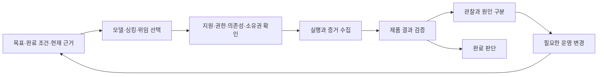

# Team Coordination: 적응형 지휘 환경 검토와 설계

상태: 구현 전 검토안. 2026-11-01에 소스와 공식 문서를 확인했다. 사용자가 이번 범위를 검토와 설계로 지정했다. 스킬, 런타임, 설치본, 기존 프로젝트 설정은 변경하지 않았다.

## 1. 판단

구현 가능하다. 기존 Team Coordination의 소유권, 실행 기록, 안전한 인계, 검증 계약을 확장하는 방식이 적합하다. 단, 모든 Codex 세션의 모델과 하위 작업을 자동으로 제어하거나 전체 청구 비용을 항상 측정할 수 있다는 보장은 할 수 없다.

목표는 **완료 조건을 유지하면서 검증된 결과까지 드는 전체 비용과 시간을 줄이는 프로젝트 운영 환경**이다. 팀의 발전은 모델 가중치 학습이 아니다. 프로젝트의 작업 분할, 배정, 문맥 전달, 도구 사용, 검증 방법을 실제 결과에 따라 갱신하는 것이다.

품질 기준을 먼저 충족한다. 그다음 비용, 완료 시간, 재작업, 사용자 개입을 비교한다. 이 지표를 근거 없는 하나의 점수로 합치지 않는다. 저렴한 단가, 짧은 답변, 빠른 첫 결과를 작업 효율로 간주하지 않는다.

## 2. 현재 구현과 확인한 제약

| 대상 | 확인 결과 | 설계에 주는 영향 |
| --- | --- | --- |
| 요청 작업 트리 | `cb710d29193deee7ec2fa9050c684ab00dd02cf5`, 런타임 `0.5.6`, 기존 미커밋 변경 존재 | 이 작업 트리를 최신 구현 기준으로 사용하지 않는다 |
| 로컬 `main` 작업 트리 | `57af6dfeaa89849d5a8d8010a6864df6553082a0`, Team Coordination `0.6.1` | 후속 구현은 이 기준을 분리한 작업 트리에서 시작한다 |
| Team Coordination 릴리스 커밋 | `7850fc468f91d404cae01a2e9c76b7b21402fb29` | 설계의 소스 근거를 이 버전에 고정한다 |
| 설치본 | `0.6.1`의 스킬 파일 31개가 최신 소스와 바이트 단위로 일치 | 설치 파일 일치만 확인했다. 활성 세션의 채택은 별도다 |
| 기존 적응형 지침 | 배정 가설, 실패 원인 구분, 독립 검토, 조건부 재사용을 설명 | 좋은 기반이다. 자동 배정과 사용량 수집 기능은 없다 |
| 역할별 모델 | 등록과 설정 변경에서 역할의 고정 모델을 요구 | 권한을 보존하면서 작업별 모델 선택을 분리해야 한다 |
| 사용량 | 마지막 턴의 `totalTokens`만 보존하고 일부 종료 상태만 집계 | 하위 작업, 재시도, 중단, 누락, 입력·출력 구분을 추가해야 한다 |
| 동시 실행 | 관리 정책의 `concurrency`가 `1` | Ultra 선택만으로 병렬 실행이 가능해지지 않는다 |

소스 근거는 위 `0.6.1` 기준의 다음 위치다.

- `team-coordination/references/adaptive-collaboration.md:3,42-65`: 지침의 범위와 학습 근거 계약.
- `team-coordination/scripts/harness.py:218-250`: 역할별 모델 고정과 정책 갱신 시 기본값 복원.
- `team-coordination/scripts/session_control.py:282-285`: 역할 모델과 다른 설정 변경 거부.
- `team-coordination/scripts/managed_run.py:72-78`: 새 실행의 역할별 기본 싱킹 선택.
- `team-coordination/scripts/session_control.py:57-59`: `last.totalTokens`만 추출.
- `team-coordination/scripts/harness.py:94-100`: 완료·실패 기록 중심의 사용량 집계.
- `team-coordination/scripts/harness.py:10-12`: 정책·역할·스키마·지정 구현 파일의 계약 해시.

순수 메모리 재현에서 완료 `7`, 실패 `3`, 불확실 `11`, 실행 안 됨 `13`의 합성 기록을 넣으면 현재 집계는 `10`과 `complete=True`를 반환했다. 이는 선택된 종료 기록의 완전성이다. 전체 시도와 하위 작업의 사용량이 수집됐다는 뜻으로 사용하면 안 된다. 합성 수치는 실제 사용량이 아니다.

## 3. 구현 방식 비교

| 방식 | 장점 | 한계 | 판단 |
| --- | --- | --- | --- |
| 스킬 문구와 추천표만 보강 | 작고 빠른 변경 | 역할 모델 고정, 사용량 누락, 적용 기록 부재가 남음 | 요청한 동작을 충족하지 못함 |
| 기존 관리 런타임에 작업별 배정·계측·조건부 규칙을 추가 | 기존 소유권과 검증 장치를 재사용하고 단계별 검증 가능 | 상태 전이, 어댑터, 배포 계약을 함께 수정해야 함 | 권장 |
| 모든 앱·세션을 제어하는 상주 자동 지휘 서비스 | 지원 범위가 충분하면 통합 제어 가능 | 공식 제어와 계측이 없는 세션까지 보장할 수 없고 유지 비용이 큼 | 현재 범위에서 채택하지 않음 |

권장안에서 리더는 작업의 의미와 상충 관계를 판단한다. 일반 코드는 지원 여부, 권한, 의존성, 소유권, 상태 전이, 사용량 중복을 검사한다. 모든 판단을 추가 모델 호출로 구현하지 않는다.

첫 지원 경로는 기존 `Controller`가 관리하는 세션이다. 기존 `managed-run`의 읽기 전용 파일럿을 쓰기 가능으로 확대하지 않는다. 구현 작업은 현재 지원되는 소유권 인계와 제한된 쓰기 범위를 사용한다. native/sidebar 세션은 공식 제어·관찰 기능이 있는 항목만 연동하며, 나머지는 제안과 미확인 상태로 표시한다. 새 상주 서비스나 별도 Agents API 실행기를 만드는 것은 초기 범위에 포함하지 않는다.

## 4. 팀이 계속 갱신할 네 가지 자산

| 자산 | 저장할 내용 | 갱신 계기 |
| --- | --- | --- |
| 프로젝트 계약 | 목표, 완료 조건, 불변 조건, 결정과 이유, 사용자 제약 | 실제 요구 또는 설계 변경 |
| 작업 그래프 | 의존성, 산출물, 실행 소유자, 검토자, 쓰기 경로, 공동 자원 | 새 작업, 병목, 통합 실패, 인계 |
| 협업 방법 | 필요한 문맥, 도구, 역할 분할, 검증 순서, 전달 방식 | 누락·재작업 또는 검증된 반복 성공 |
| 배정 근거 | 모델·싱킹·위임 선택, 관찰 결과, 적용 조건, 반례 | 완료된 작업의 유의미한 결과 |

예를 들어 검토자가 호출부 계약을 놓친 원인이 문맥 부족이면 다음 검토 패킷에 호출부를 포함한다. 곧바로 모델을 교체하지 않는다. 두 담당자의 중복 조사가 반복되면 작업 경계를 합치거나 조사 결과를 재사용한다. 화면 문제의 해석과 상태 구조의 분석이 서로 독립적이면 두 작업으로 분리한다.

이 자산은 기존 `.codex-team/state.json`을 권위 있는 기록으로 사용한다. 큰 로그와 이미지 등은 해시가 있는 증거 참조로 연결한다. 별도의 배정 장부나 전역 메모리 복사본을 만들지 않는다. 패킷에는 현재 작업에 필요한 규칙과 근거만 투영한다.

채택할 규칙에는 배정·문맥·작업 분할·검증·도구 중 적용 종류와 실제 조치를 적는다. 예를 들어 문맥 규칙은 관련 호출부 참조를 패킷에 추가하고, 검증 규칙은 해당 완료 조건에 필요한 기존 검사 항목을 연결한다. 실행기는 지원되는 구조의 조치만 적용한다. 자유 문장을 임의의 셸 명령으로 실행하거나 필수 검사를 삭제하지 않는다.

## 5. 배정은 세 가지 판단으로 구성한다

1. **필요한 능력:** 화면 해석, 제한된 코드 수정, 광범위한 구현, 구조 설계, 반복 추출 등으로 후보 모델을 고른다.
2. **남은 판단의 깊이:** 아직 풀어야 할 조건과 상충 관계에 맞춰 싱킹을 고른다.
3. **독립 작업 여부:** 의존성, 쓰기 경로, 공동 도구, 결과 취합 비용을 보고 직접 수행·기존 담당자 재사용·위임을 고른다.

서비스 속도는 별도 설정이다. Normal 요청, 실제 전송 값, 수락 응답, 관찰 가능한 설정, 확인할 수 없는 provider 실행 상태를 구분한다.

배정의 우선순위는 명시적 사용자 제약 → 채택된 프로젝트 규칙 → 해당 작업의 근거 → 초기 후보표다. 기존의 전역 Astra High 등 요청 기본값을 자동으로 덮어쓰지 않는다. 아래 표는 새 작업별 정책으로 채택할 제안이며, 현재 세션이 이 설정으로 변경됐다는 뜻이 아니다.

| 작업 | 초기 후보 | 더 깊은 판단이 필요한 조건 |
| --- | --- | --- |
| 확정된 추출·분류·반복 보조 | Luna Low | 누락 원인을 확인한 뒤 범위·문맥·모델을 조정 |
| 화면 검토·교정·UI 문구 | Terra Medium | 여러 상태와 시각 규칙이 얽히면 High; 깊은 시각 해석이 병목이면 Max 비교 |
| 범위가 명확한 UI 코드 수정 | Terra Medium | 상태 소유권이나 넓은 코드 구조로 확장되면 Sol과 비교 |
| 일반 기능 개발·통합 | Sol Medium | 비동기·예외·의존성이 얽히면 High 이상 |
| 깊은 원인 분석·구조 결정 | Sol High 또는 Astra High | 서로 연결된 불변 조건의 검토가 핵심이면 Max를 처음부터 고려 |
| 일상적인 조정 | Sol Medium | 설계 판단을 별도 구간으로 분리하거나 적합한 모델·싱킹을 선택 |
| 복수 영역의 깊은 분석과 취합 | 지원되는 적합한 모델의 Ultra | 독립 작업, 담당 범위, 하위 모델·싱킹, 취합 방법이 구체적이어야 함 |

Terra는 일상적인 디자인과 화면 중심 개발의 주요 후보로 둔다. 공식 문서도 화면 기반 작업과 범위가 정해진 코드 수정을 용도로 설명한다. 이 설명이 미적 품질의 보편적 순위를 입증하지는 않는다. [공식 모델 선택 안내](https://developers.openai.com/api/docs/guides/model-selection)

Standard 크레딧 단가는 100만 토큰당 Terra 입력/캐시 입력/출력 `25 / 1.25 / 125`, Sol `50 / 2.5 / 250`이다. 세 항목 모두 Terra가 절반이다. 단가와 실제 작업 비용은 별개이며, 이 비율을 포함 사용량이나 전체 작업 절감률로 환산하지 않는다. 요율은 코드 상수로 영구 고정하지 않고 출처·적용일·단위를 보존한다. [공식 크레딧 요율](https://learn.chatgpt.com/docs/pricing#token-rates)

## 6. Low부터 Ultra까지의 운영 기준

| 설정 | 판단 기준 | 예 |
| --- | --- | --- |
| Low / Light | 방법과 변경값이 확정됨 | 지정한 간격·명칭·스타일 변경 |
| Medium | 관련 자료를 읽고 제한된 구현 방법을 선택함 | 일반 UI 수정, 범위가 분명한 결함 수정 |
| High | 여러 조건과 원인 가설을 함께 판단함 | 화면 상태, 비동기 동작, 예외 경로 |
| Extra High | 확보한 근거를 더 깊게 비교·추적함 | 복잡한 결함의 인과관계, 설계 상충 관계 |
| Max | 강하게 연결된 조건을 최대한 깊게 검토함 | 순서 역전·중복·오프라인·삭제·복구가 얽힌 동기화 |
| Ultra | 최대 추론에 적합한 독립 작업의 적극적 위임을 결합함 | 화면 관찰·코드 추적·검증 분석을 나누고 결과를 종합 |

Low부터 순차적으로 올리는 절차를 강제하지 않는다. 충분한 근거가 있으면 처음부터 Max 또는 Ultra를 선택한다. 높은 설정의 기록에는 **추가로 해결할 판단**을 적고, Ultra에는 **독립적으로 나눌 작업과 취합 책임**도 적는다. 같은 싱킹 이름이 모델 간 동일한 성능이나 소비량을 뜻하지 않는다. [공식 싱킹 안내](https://learn.chatgpt.com/docs/models)

Max에서도 명시적인 위임을 사용할 수 있다. Ultra는 위임 기능을 독점하는 설정이 아니다. 기존 팀의 모든 담당자를 Ultra로 고정하지 않고, 하위 담당자의 모델과 싱킹을 함께 명시한다. 공식 설정의 상속 규칙과 실제 클라이언트 제어를 확인한다. [공식 하위 에이전트 안내](https://learn.chatgpt.com/docs/agent-configuration/subagents)

Terra API의 문서화된 추론 값은 `max`까지다. 호스트가 `ultra`를 제공할 수 있으나 이를 API의 동일한 값으로 전송하면 안 된다. 어댑터별 지원 목록과 제어 의미를 확인한다. Light 등의 화면 표시 이름도 확인 없이 wire 값으로 바꾸지 않는다. [Terra API 계약](https://developers.openai.com/api/docs/models/gpt-6.1-terra)

Ultra와 Ultrafast는 별개다. 속도 옵션의 사용량 배수를 Ultra에 적용하지 않는다. [공식 속도 설정](https://learn.chatgpt.com/docs/agent-configuration/speed)

## 7. 실행과 개선의 순환



운영 변경은 새 작업, 유의미한 실패·재작업, 병목, 환경 변화, 단계 종료 시 검토한다. 매 턴마다 배정 회의를 열거나 별도 평가 모델을 호출하지 않는다. 잘 작동하는 배정은 관련 근거나 조건이 바뀔 때까지 재사용한다.

역할은 책임과 권한을 나타낸다. 모델은 그 역할이 현재 작업을 수행하는 수단이다. 둘을 분리하되 리더의 조정 범위, 구현 담당자의 쓰기 범위, 검토자의 독립성은 유지한다. 조사 결과가 없다는 이유만으로 새 팀을 반복 생성하지 않는다.

병렬화는 작업 그래프와 실제 실행 용량에 따라 허용한다. 같은 파일의 경쟁 작성, 같은 화면의 동시 조작, 앞선 결론을 기다리는 작업은 병렬화하지 않는다. 관리 동시성 값이 `1`이면 분할해 순차 수행할 수는 있어도 병렬 이익을 주장하지 않는다. 용량 변경은 별도 명시된 프로젝트 정책으로 채택한다.

하위 재위임도 같은 그래프와 소유권에 등록한다. 등록되지 않은 내부 하위 작업까지 어댑터가 통제했다고 주장하지 않는다. 호스트의 자율 위임을 강제할 제어가 없으면 지침 수준의 제약임을 표시한다.

## 8. 런타임 확장 계약

아래 이름과 구조는 새 구현 제안이다. 현재 실행할 수 있는 명령이나 이벤트 이름이 아니다.

| 기록 | 최소 내용 | 책임 |
| --- | --- | --- |
| 작업별 배정 | 작업 ID, 완료 조건, 사용자 제약, 모델·싱킹·서비스 요청, 위임 방식, 선택 이유, 재검토 조건, catalog 근거 | 리더 판단을 실행 가능한 선택으로 고정 |
| 실행 시도 | 시도 ID, 배정 ID, 부모 시도, 재시도 대상, thread/turn ID, 목적, 시작·종료·불확실 상태 | 실패와 재시도를 지우지 않고 연결 |
| 사용량 관찰 | 출처 ID, 관찰 범위, 원본 참조, 입력·캐시·출력·추론 토큰, 수정 순서, 집계 포함 관계 | 중복·누락·부분 합계를 구분 |
| 조건부 운영 규칙 | 관찰, 다른 원인 후보, 변경, 제품 결과, 검토, 적용 조건, 무효 조건, 이전 규칙 참조 | 다음 작업에서 재사용할 근거를 보존 |

배정 상태는 `제안 → 프로젝트 권한 내 채택 → catalog 확인 → 예약 → 실행 → 종료 또는 불확실`로 구분한다. 권한 내 채택은 매번 사용자에게 승인받는 절차가 아니다. 프로젝트에 위임된 범위에서 리더가 결정한다.

배정 변경은 새 작업 또는 소유자가 확인한 안전한 경계에서 적용한다. 실행 중인 소유자를 몰래 교체하지 않는다. 불확실한 전송은 먼저 결과를 대조하고, 새 ID를 만들어 중복 실행하지 않는다. 요청·수락·설정 관찰·실행 결과의 증거를 분리한다.

`policy_refresh`는 작업별 선택을 무조건 역할 기본값으로 되돌리면 안 된다. 새 계약에서도 유효한 선택은 보존한다. 무효가 된 선택에는 이유를 기록하고 다음 실행 전에 다시 결정한다. 현재의 단일 기록 잠금, revision/epoch, 계약 digest, 패킷 ACK를 확장한다.

`SKILL.md`와 적용되는 운영 참조도 버전별 계약에 연결해야 한다. 현재 코드는 모든 참조 문서 변경을 ACK에 결합하지 않는다. 새 모듈과 실행에 영향을 주는 지침을 계약 해시에 포함하고, 관련 변경에만 안전한 재채택을 요구한다.

사용량·증거 추가와 실행 지시 변경은 서로 다른 변경으로 취급한다. 관찰값이 추가될 때마다 instruction revision을 올리거나 실행 중 ACK를 무효화하면 안 된다. 채택된 결정이나 계약이 달라질 때 현재 안전 경계 절차를 적용하고, 다음 패킷에 적용 규칙 ID와 버전을 기록한다.

## 9. 사용량과 경제성

과업 단위 집계는 리더의 조정, 실행 담당자, 하위 에이전트, 검토, 재작업, 재시도, 설정 확인에 사용한 호출을 포함한다. 제공되는 도구·외부 서비스 비용도 별도 항목으로 보존한다. 시간은 경과 시간과 담당자 작업 시간 합계를 구분한다.

작업 기록에는 집계 대상 시도 목록을 두고, 관리 경로 밖의 리더·검토·자식 실행도 관찰 가능한 ID와 출처로 연결한다. 사용량을 읽을 수 없는 실행은 목록에서 빼지 않고 미수집으로 표시한다. 등록되지 않은 외부 실행이 없는지 보장할 수 없으면 그 범위를 명시한다. 로그 추정이나 모델의 자기 보고를 provider 계측으로 승격하지 않는다.

사용량 이벤트는 실행 종료와 별개로 저장한다. 실패·중단·불확실 실행에서 이미 관찰된 사용량을 버리지 않는다. 같은 알림은 한 번만 반영하고, 늦은 정정은 해당 원본 ID의 수치를 갱신한다. 입력·출력의 합계에 이미 포함된 캐시·추론 토큰을 다시 더하지 않는다. 부모 집계에 자식이 포함됐는지 확인할 수 없으면 둘을 단순 합산하지 않는다. [공식 사용량 계측 원칙](https://developers.openai.com/api/docs/guides/agents-api/observability)

집계 결과는 `관찰된 토큰`, `집계 범위`, `미수집·중복 가능 항목`, `요율 근거`, `비용 추정 가능 여부`를 함께 제공한다. 완전성은 등록된 실행 트리에 대해 판단한다. provider 내부 재시도나 관찰되지 않는 자식의 존재를 배제할 수 없으면 전체 청구 비용의 완전성을 주장하지 않는다. `unknown`은 0이 아니다.

비교는 같은 완료 조건을 충족한 결과를 대상으로 한다. 입력, 도구, 문맥, 검증 강도가 달라졌으면 차이를 기록한다. 전체 사용량이 불완전하면 완료 시간이나 관찰된 재작업은 비교할 수 있지만 총비용 우위를 확정하지 않는다. 사용자에게 필요한 완료 조건을 줄여 절감을 만들지 않는다.

비교가 필요한 경우 `Terra High ↔ Terra Max`, `Terra Max ↔ Sol Medium/High`, `Sol Max ↔ Astra High`, `Max ↔ Ultra`처럼 실제 남은 판단에 맞는 후보를 고른다. 매 작업에서 모든 조합을 시험하지 않는다. 성공과 실패, 쉬운 사례와 필수 난제의 결과를 함께 보존하고, 여러 조건을 동시에 바꿨으면 어느 변경이 효과를 냈는지 확정하지 않는다.

Max는 추가 추론이 결함과 재작업을 줄였는지 평가한다. Ultra는 여기에 위임·입력 전달·취합 비용과 경과 시간 이익을 더해 평가한다. 고정된 토큰 배수, 가상 과금, 임의 내부 예산, 정해진 검토 횟수는 도입하지 않는다. 실제 사용자 제약과 provider 한도는 유지한다.

## 10. 운영 규칙의 채택과 철회

제품의 통과 여부와 배정 방법의 유효성은 별도로 판단한다. 제품이 통과해도 배정 근거는 잠정적일 수 있다. 배정 방법이 좋아 보여도 제품의 실패를 통과로 바꾸지 않는다.

운영 규칙은 `관찰 → 잠정 가설 → 조건부 지지 / 반박 / 근거 부족`으로 구분한다. 반복되는 관련 증거와 독립 검토가 있을 때만 프로젝트 규칙으로 채택한다. 고정 실험 횟수 대신 실패 영향, 증거의 다양성, 반례와 비교 가능성을 본다. 변경을 제안하거나 작성한 사람이 자기 변경의 효과를 독립 검토했다고 표시하지 않는다.

현재 과업의 가역적 조정은 기존 권한 안에서 진행할 수 있다. 프로젝트 규칙은 적용 범위와 철회 조건을 붙인다. 전역 스킬·사용자 기본값 갱신은 별도 유지보수 권한이 있을 때만 수행한다. 완료된 프로젝트를 다시 실행하지 않는다.

모델 또는 버전, 도구, 문맥 구성, 작업 종류, 완료 조건이 바뀌면 이전 증거의 적용 범위를 다시 확인한다. 반례를 지우지 않고 이전 규칙을 보존한다. 추가 실험이 배정을 바꿀 근거를 만들지 못하거나 납품을 지연시키면 선택적 실험을 종료한다. 필요한 결함 분석과 검증은 계속한다.

예를 들어 키보드에 버튼이 가려지는 SwiftUI 수정은 Terra Medium으로 재현·제한된 수정·화면 재검증을 시작할 수 있다. 원인이 여러 화면의 상태 소유권에 있다는 근거가 나오면 범위를 다시 정의하고 Sol 또는 Astra의 깊은 판단을 배정한다. 실제 화면 문제가 해결됐는지와 그 배정이 경제적이었는지는 별도로 평가한다.

Watch와 iPhone의 동기화에서는 순서 역전·중복·삭제·복구의 불변 조건을 검토하는 구간에 Max를 처음부터 배정할 수 있다. 결정된 설계의 구현은 다른 설정의 담당자가 이어받을 수 있다. 서로 독립적인 구현 경로·테스트 공백·기기 동작 조사가 있으면 Ultra를 비교하되, Simulator 결과를 실제 기기 증거로 바꾸지 않는다.

## 11. 구현 순서와 완료 조건

| 단계 | 구현 범위 | 다음 단계로 넘어갈 근거 |
| --- | --- | --- |
| 1. 작업별 선택 | 역할 권한과 모델 분리, 세 판단 기록, 정확한 모델·싱킹 검증, 안전한 적용 | Terra Medium 선택과 인간 지정 모델 보호를 모두 통과; 기존 권한·소유권 회귀 없음 |
| 2. 전체 시도 계측 | 부모·자식·재시도 연결, 이벤트 중복 제거, 실패 시 보존, 집계 범위 표시 | 합성 실행 트리의 정확한 집계; 누락·중복·늦은 정정에서 과장된 완전성 없음 |
| 3. 운영 규칙 순환 | 근거 기반 프로젝트 규칙, 독립 검토, 반례, 철회, 패킷 갱신 | 자기 승인·오래된 증거·조건 불일치로 규칙이 확정되지 않음 |
| 4. 실제 과업 평가 | 대표 UI 수정, 복잡한 상태 설계, 독립 조사와 취합 과업에서 관찰 | 같은 완료 조건의 결과·재작업·시간·수집 범위를 보고; 절감은 측정된 경우에만 주장 |

단계 1~3은 하나의 설계에 속하지만 나누어 검증한다. 실제 과업 평가는 기존 승인된 작업을 우선 사용한다. 별도 유료 벤치마크를 무조건 실행하거나 외부 부작용이 있는 작업을 반복하지 않는다. 실제 평가 전까지 경제성은 가설로 표시한다.

필수 회귀 사례는 다음과 같다.

- Terra Medium, Max, Ultra를 각각 지원하는 catalog와 지원하지 않는 catalog. 자동 별칭·무단 대체 금지.
- 모델 변경 후에도 역할 권한, 단일 작성자, 검토 독립성, 사용자 고정 선택 유지.
- 동시성 `1`, 공유 화면, 파일 충돌, 선행 의존성, 기존 팀 재사용.
- 부모·자식·재시도, 누락·중복·순서 역전·늦은 정정, 중단·실패·불확실 실행, 재시작 후 복구.
- 부모의 자식 포함 합계와 자식 개별 합계의 중복 방지. 관찰 범위 밖의 사용량은 미확인 유지.
- 자식 실행을 모두 측정했어도 리더·검토 사용량이 없으면 전체 과업 집계를 완전하다고 표시하지 않음.
- 다른 작업 실행 중 늦은 사용량 정정이 도착해도 그 작업의 instruction revision과 ACK가 바뀌지 않음.
- 호출부 누락 관찰 → 조건부 문맥 규칙 → 다음 검토 패킷의 호출부 포함 → 관련 ACK 갱신 → 조건 변경 시 규칙 적용 제외를 연결해서 검사.
- 제품 통과와 학습 판정 분리. 자기 승인, 한 번의 성공, 불충분한 계측으로 일반 규칙 확정 금지.
- 정책 갱신과 계약 재채택, 오래된 ACK 거부, 기존 결정·실패·소유권 보존.
- 기존 `test_budget_free.py` 회귀 유지. 내부 가상 예산·검토 횟수 제한 재도입 금지.

후속 변경 대상은 `team-coordination/`의 스킬·참조·역할·정책·스키마·런타임, Plugin 미러와 UI 메타데이터, `tools/codex-team-harness/`의 payload·테스트·manifest·릴리스 목록, README와 CHANGELOG다. Plugin 추가·삭제는 필요하지 않다. 설치·배포·기존 팀 채택은 소스 구현과 별도 결과로 보고한다.

## 12. 이번 검토의 검증 범위

최신 `0.6.1` 소스에서 기존 설정·세션 제어·내부 예산 제거 계약의 65개 테스트가 통과했다. 이는 현재 기반의 회귀 결과이며, 위 새 설계의 구현 또는 성능 검증은 아니다.

실행 명령:

```sh
# 최신 main 작업 트리의 tools/codex-team-harness/tests 에서 실행
python3 -B -m unittest -v test_profile_defaults test_session_control test_budget_free

# 요청 작업 트리에서 새 설계 문서를 포함한 로컬 링크 검사
python3 -B -m unittest discover -s scripts/tests -p test_document_links.py -v
```

기반 테스트 65개와 문서 링크 테스트 2개가 통과했다. 별도 `python3 -I -S -B` 메모리 검사에서 현재 집계의 완전성 한계를 재현했다. 합성 catalog에서 Terra의 Medium·Max·Ultra를 각각 명시적으로 지원할 때만 허용하고, Max만 지원할 때 Ultra를 거부하는 것도 확인했다. 이는 실제 계정의 실행 지원 검증이 아니다.

전체 로그:

- `/tmp/team-coordination-feasibility-20261101/baseline-tests.log`
- `/tmp/team-coordination-feasibility-20261101/document-links.log`
- `/tmp/team-coordination-feasibility-20261101/feasibility-probes.log`

소스 구조·설치 파일 일치·공식 문서·합성 메모리 사례를 확인했다. 새 모델의 유료 실행, 실제 UI 수정 비교, 런타임 자동 배정, 전체 비용 절감, 설치본 변경, 활성 팀의 새 계약 채택은 수행하지 않았다.

독립 설계 검토에서 첫 지원 어댑터, 과업 전체의 계측 대상, 관찰과 지시 변경의 분리, 규칙의 실제 패킷 반영을 보완했다. 보완본에서 추가로 해결해야 할 중대한 설계 공백은 발견되지 않았다. 이는 설계 검토 결과이며 구현 또는 운영 성능의 통과 판정이 아니다.
