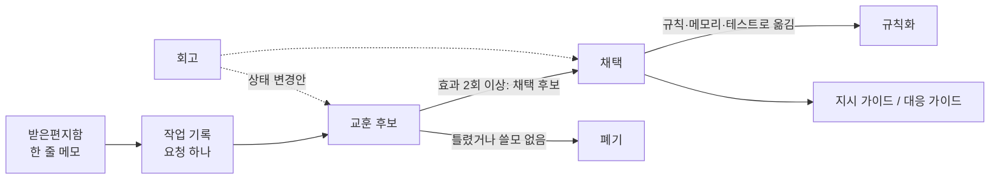

# 위키 사용법

이 위키는 {{project}} 작업에서 생긴 일을 모아 다음 작업을 더 낫게 한다. 사용자와 에이전트가 함께 쓴다. 위키 폴더는 git에 올리지 않는다.

## 기록이 자라는 순서

1. **받은편지함**: 생각난 것을 [[받은편지함]]에 한 줄로 적는다. 형식은 따지지 않는다.
2. **작업 기록**: 요청 하나가 끝나면 `10 작업 기록/`에 노트 하나를 만든다. 요청 원문, 결과, 지시 쪽 회고, 대응 쪽 회고를 쓴다. 템플릿: [[작업 기록 템플릿]].
3. **교훈**: 작업 기록에서 다음에도 쓸 만한 것을 `20 교훈/`에 노트 하나로 뽑는다. 노트 하나에 교훈 하나만 쓴다. 템플릿: [[교훈 템플릿]].
4. **적용 기록**: 교훈을 다시 썼으면 그 교훈의 "적용 기록" 표에 한 줄을 더한다. `효과` 칸에는 `있음`, `없음`, `모름`, `미적용` 중 하나를 쓴다. `미적용`은 교훈이 있었는데 따르지 않아 실패하거나 다시 한 경우다. `applied`는 `미적용`을 뺀 줄 수, `worked`는 `있음`인 줄 수, `missed`는 `미적용`인 줄 수다. 같은 교훈이 두 번 이상 `미적용`이면 글보다 규칙이나 검사로 옮길 후보다. 에이전트는 이 기록과 숫자, `last_seen`을 묻지 않고 고친다.
5. **상태 바꾸기**: 상태는 회고나 fstack reflect에서 사용자가 고른다. 에이전트는 변경안만 낸다.
   - `candidate`: 한 번 겪은 일에서 나온 교훈.
   - `adopted`: 효과가 2회 이상 확인되어 사용자가 채택했다. [[효과적인 지시 방법]]이나 [[에이전트 대응 원칙]]에 반영한다.
   - `encoded`: 사람이 기억하지 않아도 지켜지게 옮겼다. 옮긴 곳을 `encoded_in`에 적는다(예: `메모리: <파일 이름>`, `CLAUDE.md`, 스킬, 테스트, 스크립트). 이미 있는 규칙을 가리키는 교훈은 처음부터 `encoded`로 쓴다.
   - `retired`: 틀렸거나 더 이상 맞지 않는다. 지우지 말고 이유를 남긴다.
6. **회고**: 큰 작업 묶음이나 출시가 끝나면 `60 회고/`에 회고를 쓴다. 받은편지함을 비우고 교훈 상태 변경안을 낸다. 템플릿: [[회고 템플릿]].

## 누가 언제 쓰는가

| 때 | 사용자 | 에이전트 |
|---|---|---|
| 작업 중 | 거슬린 점, 좋았던 점을 받은편지함에 한 줄 | 예상과 다른 사실을 받은편지함에 한 줄 |
| 요청 하나가 끝났을 때 | 결과에 대한 느낌을 "회고: 지시"에 한 줄 | 작업 기록을 쓰거나 "위키에 남길까요?"를 한 줄로 묻는다 |
| 같은 교정을 두 번 했을 때 | "이거 교훈으로 남겨줘" | 교훈을 만들고 규칙으로 옮길 곳을 제안 |
| 회고 때 | 상태 변경안에서 고른다 | 숫자를 세고 변경안을 낸다 |

## 쓰는 규칙
- 사실과 추정을 나눈다. 추정이면 "추정"이라고 쓴다.
- 숫자에는 조건을 붙인다(빌드, 기기, 설정).
- 근거는 커밋, 파일 경로, 사용자 발언 원문으로 남긴다.
- 실패를 지우지 않는다. 실패한 작업 기록과 폐기한 교훈도 남긴다.
- 개인 정보(메일 주소, 위치, 공유 링크의 토큰)와 비밀 값은 쓰지 않는다.
- 제목에 `/ \ : # ^ | [ ]`를 쓰지 않는다. `/`는 폴더를 만든다.
- 별칭으로 링크하지 않는다. `[[노트 제목|보이는 글]]`로 쓴다.

## 대시보드
- [[교훈.base|교훈 대시보드]]: 후보, 채택, 규칙화, 대상별
- [[작업 기록.base|작업 기록 대시보드]]: 최근, 실패와 부분 성공, 진행 중
- [[지식.base|지식 대시보드]]: 영역별, 오래 확인하지 않은 것

## Obsidian에서 열기
Obsidian에서 "폴더를 보관함으로 열기"로 이 폴더를 연다. 템플릿 코어 플러그인을 켜면 `90 템플릿`의 템플릿을 쓸 수 있다. 대시보드는 Bases 코어 플러그인이 필요하다.
